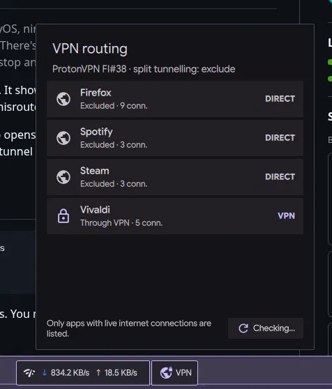

# VPN Routes

> **Disclaimer:** I've only tested this on my own setup: CachyOS, niri, Dux Shell 2.0, and the official Proton VPN Linux app (WireGuard, split tunnelling daemon v0.13.x). There's no guarantee it works anywhere else. Use it at your own risk, especially the restart buttons, which stop and start apps.

This is a [Dux Shell](https://duxlabs.dev) (formerly DankMaterialShell) bar widget. It shows which apps **actually** go through the Proton VPN tunnel and which go direct, and it can restart misrouted apps.

Proton's split tunnelling only applies to connections an app opens *after* Proton starts tracking it. An app that was already running when the VPN connected stays in the tunnel until it's restarted, and nothing on screen tells you.



## Install

```sh
git clone <this repo> ~/.config/dms/plugins/VpnRoutes
dms ipc call plugin-scan scan
dms ipc call plugins enable vpnRoutes
```

Then add **VPN Routes** to the bar in DMS Settings → Plugins. You need `python3`, `ss`, `nmcli` and `systemd-run`. It doesn't need root.

## Usage

The bar icon shows the overall state:

- **Blue lock:** everything is routed as configured.
- **Amber warning:** some excluded apps are still using the VPN, so they need a restart.
- **Red shield:** an app that should use the VPN is going direct (a leak).
- **Grey:** the VPN is off.

Click the icon to see each app with live internet connections and how it's routed. Misrouted apps get a ⟳ button: click once to arm it, then again to restart the app. A setting adds the button to every app.

## How it works

- **Routing check:** `vpn-routes.py` reads established sockets with `ss`. A socket's source address shows the route the kernel actually chose: the tunnel IP on `proton0` means VPN, the LAN IP means direct. The script compares that with `~/.config/Proton/VPN/settings.json`.
- **Ignored traffic:** connections to LAN, loopback and Tailscale addresses are skipped, because they never use the tunnel.
- **Matching:** like Proton, an app counts as excluded if it or any ancestor matches a configured path. Both the real binary and the path it was launched as are checked, since Proton doesn't resolve symlinks.
- **Restart:** the app's top process gets SIGTERM, or a per-app `stop` command. The script waits for it to exit, then relaunches each separate instance in its own `systemd-run --user --scope` (Flatpak apps via `flatpak run`). If a relaunch fails straight away, the widget tells you instead of reporting success. It never SIGKILLs: if the app won't quit, it's left running. The shell, compositor, systemd, D-Bus, PipeWire, the Proton app and anything run by Python are never touched.

### `restart.json`

These are per-app overrides, keyed by the app name shown in the widget:

| Field | Meaning |
|---|---|
| `stop` | Command to run instead of sending SIGTERM |
| `launch` | Command to run instead of the app's original command line |
| `block_if` | Regex; if any running process matches it, the restart is refused |
| `timeout` | Seconds to wait for the app to quit (default 20) |

Steam, Spotify, Brave Origin and Vivaldi have overrides included:

- **Steam** is stopped with `steam -shutdown`, and restarting is blocked while a game is running.
- **Spotify** ignores SIGTERM, so it's quit over MPRIS instead.
- **Brave Origin and Vivaldi** are relaunched through their wrapper scripts.

## Gotcha: symlinked launchers

Proton matches the path an app is **launched as**, without resolving symlinks. If `/usr/bin/foo` is a symlink to `/usr/lib/foo/foo`, excluding only `/usr/lib/foo/foo` won't work. Add the launcher path too.

The Proton GUI resolves symlinks when you pick an app, so edit `settings.json` directly, with the Proton app fully quit. To check whether an app was matched, run `journalctl -u proton.VPN | grep "Process match"`.

## Debugging

```sh
python3 vpn-routes.py | jq                          # the widget's data in a terminal
python3 vpn-routes.py restart --dry-run <key>       # what a restart would stop and launch; does nothing
dms ipc call plugins reload vpnRoutes               # reload after editing
```

`<key>` is the app's `key` from the report: its matched exclude path, or its process name.

## Development

The tests never touch real processes: process trees are faked and `ss`, `kill` and `systemd-run` are mocked. They need nothing beyond Python:

```sh
python3 -m unittest
```

Linting, formatting and pytest are optional and live in a local virtualenv (configured in `pyproject.toml`):

```sh
python3 -m venv .venv && .venv/bin/pip install ruff pytest
.venv/bin/ruff check .     # lint
.venv/bin/ruff format .    # format
.venv/bin/pytest           # same tests, nicer output
```
